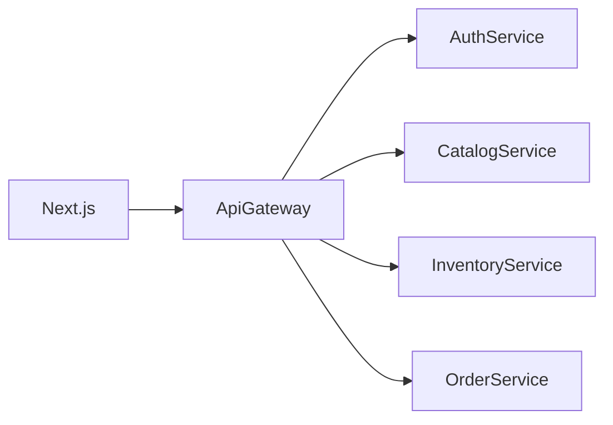

# 架构

五个服务连接同一个 MySQL 库 `consumer_shop`。表的写入归属如下：

| 服务 | 表 |
| --- | --- |
| 鉴权 | users, auth_events |
| 商品 | categories, products |
| 库存 | inventory_items, inventory_reservations, inventory_reservation_items, inventory_adjustments |
| 订单 | orders, order_items, order_events, idempotency_keys |

订单服务读取商品和库存时走内部 HTTP，并携带 `x-internal-token` 和 `x-request-id`。它不直接改商品表或库存表。

下单顺序：

1. 网关校验 JWT。
2. 订单服务写入“创建中”订单和幂等记录。
3. 向商品服务核对在售状态和当前价格。
4. 向库存服务预占。库存不足则订单记为失败，可用库存不变。
5. 写入订单明细快照并确认库存，订单变为已创建。
6. 若库存调用超时，订单留在创建中。`scripts/recover_orders.py` 再查预占状态：没有预占就失败，已经预占且有明细就确认并完成创建。

取消已创建订单会把已确认的库存加回一次。重复取消看到订单已是取消状态，不再调用库存。
